# tanda_dolorena

## Prueba 1
### Error
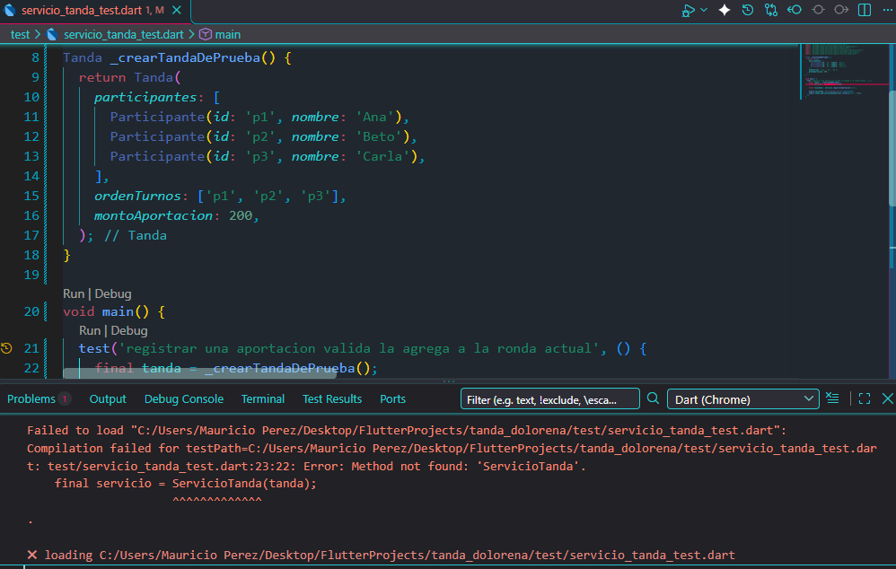
### Paso
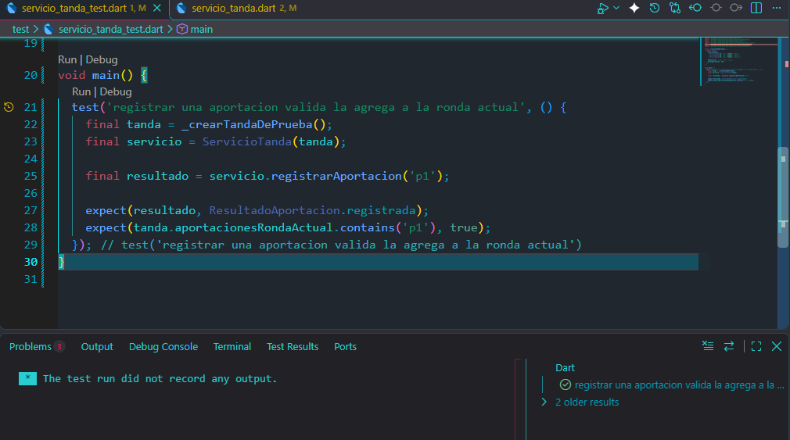

## Prueba 2
### Error
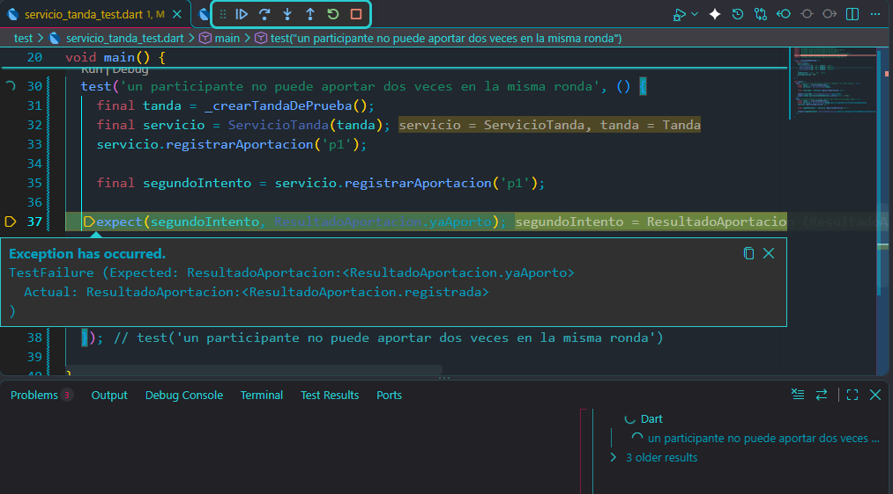
### Paso
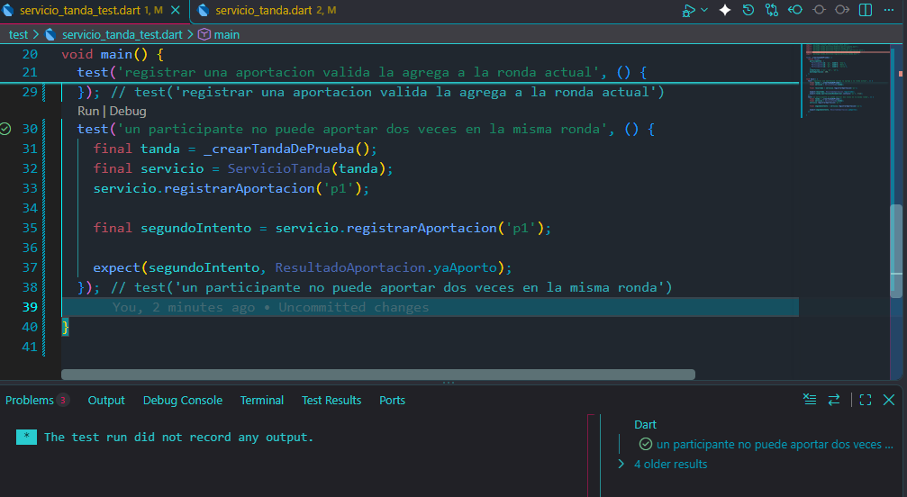

## Prueba 3
### Error
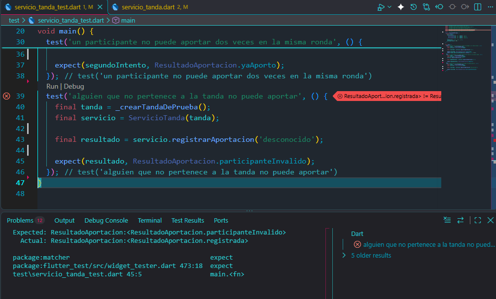
### Paso
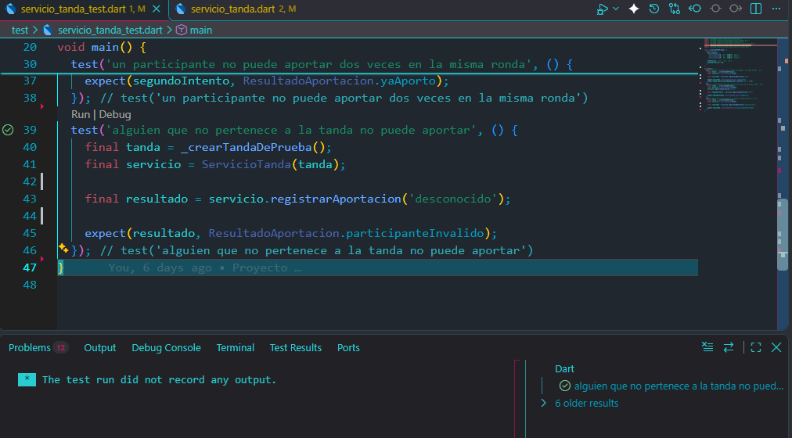

## Prueba 4
### Error
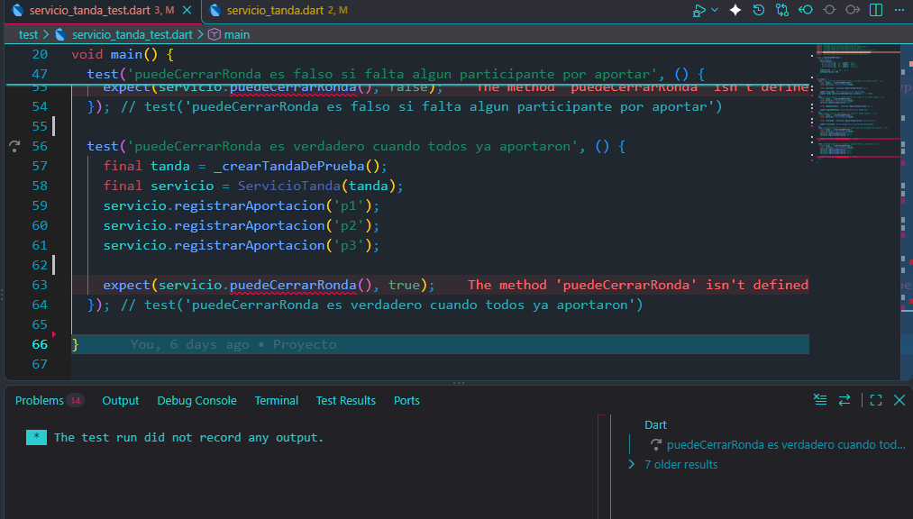
### Paso
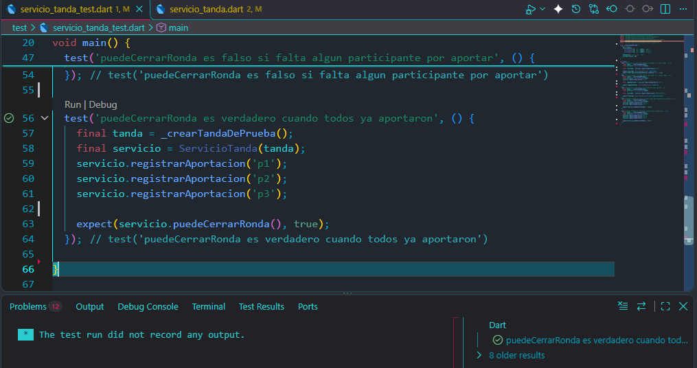

## Prueba 5
### Error
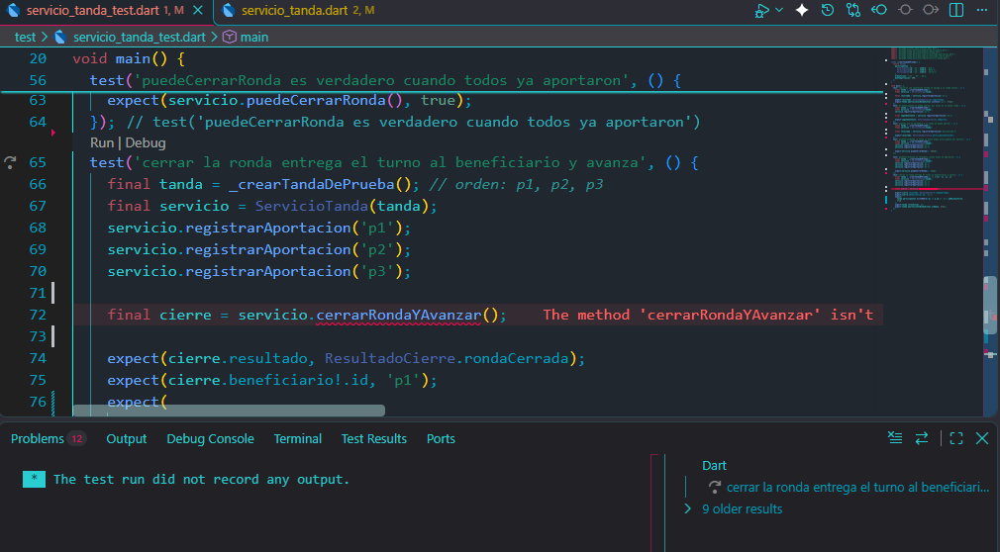
### Paso
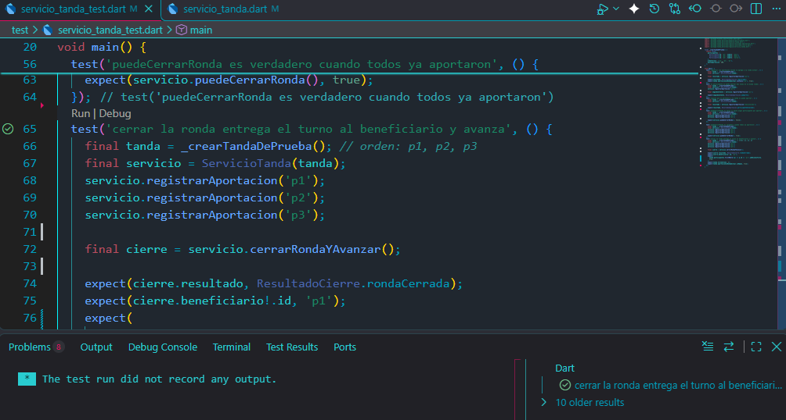

## Prueba 6
### Paso
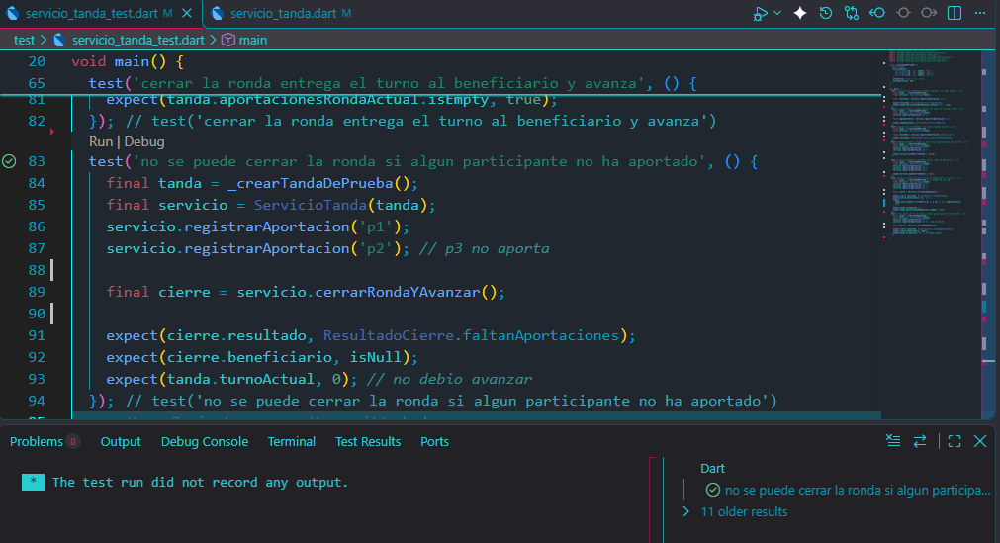

## Prueba 7
### Error
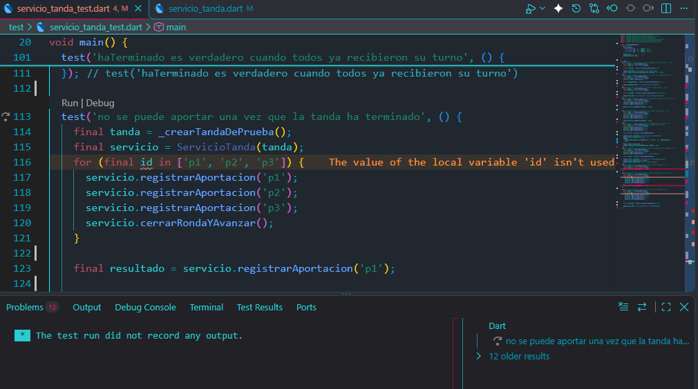
### Paso
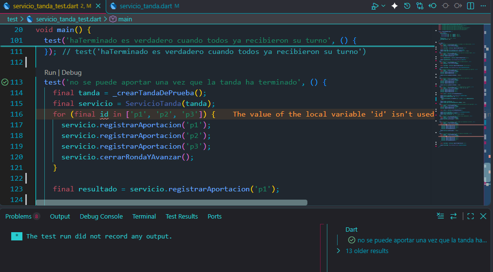

## Prueba 8
### Paso
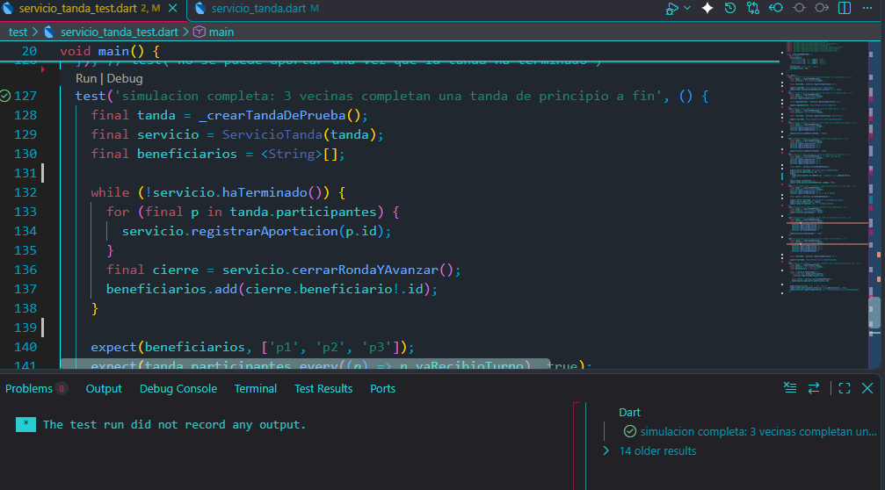

## Funcionamiento de aplicación
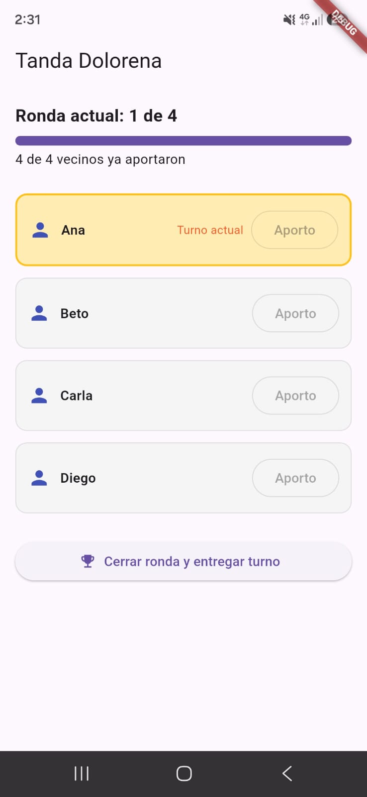

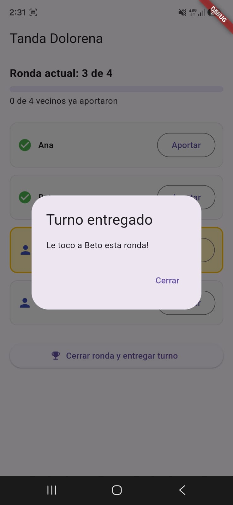

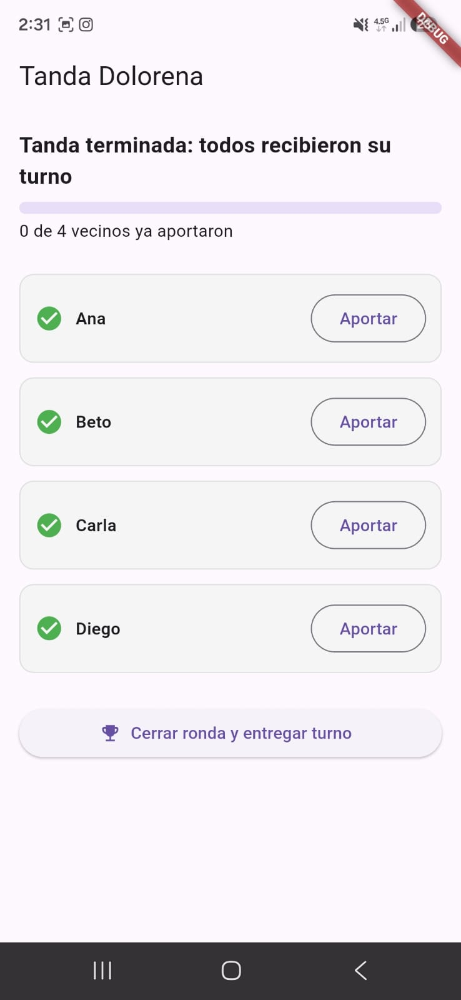